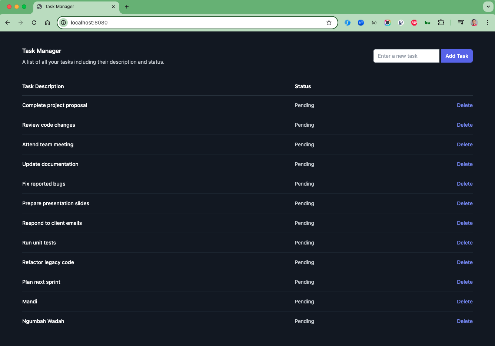

# Spring Boot & JTE & HTMX Tasks

[](https://github.com/hendisantika/spring-boot-jte-task/actions/workflows/maven.yml)


This project demonstrates a simple task management application built with Spring Boot, JTE (Java Template Engine), and HTMX. It showcases how to create a responsive web application with server-side rendering and dynamic updates.

## Technologies Used

- Java 25 (Temurin)
- Spring Boot 4.1.x (Spring Web MVC)
- JTE 3.2.x (`jte-spring-boot-starter-4` + `jte-maven-plugin` for precompiled templates)
- HTMX (for dynamic frontend updates)
- Tailwind CSS (via CDN)
- Lombok
- Maven (via Maven Wrapper)

## Prerequisites

- JDK 25 (`java -version` should print `25`)
- No local Maven needed, the project ships with the Maven Wrapper (`./mvnw`)

## Things todo list

1. Clone this repository: `git clone https://github.com/hendisantika/spring-boot-jte-task.git`
2. Navigate to the folder: `cd spring-boot-jte-task`
3. Run the application: `./mvnw clean spring-boot:run`
4. Open your favorite browser: http://localhost:8080

### Build & Test

```shell
./mvnw clean verify
```

## Endpoints

| Method   | Path                | Description                                         |
|----------|---------------------|-----------------------------------------------------|
| `GET`    | `/`                 | Home page with the task list                        |
| `POST`   | `/add-task`         | Add a task (form param `description`), returns a row |
| `DELETE` | `/delete-task/{id}` | Delete a task by id (called by HTMX)                |

Tasks are stored in memory, so they are reset whenever the application restarts.

## Project Structure

```
src/main/java/id/my/hendisantika/jtetask
├── controller/TaskController.java   # MVC + HTMX endpoints
├── model/Task.java                  # Task model
└── repository/TaskRepository.java   # In-memory repository
src/main/jte
├── index.jte                        # Main page
├── task-table.jte                   # Task table
└── task-row.jte                     # Single task row (HTMX fragment)
```

## CI/CD & Dependency Updates

- **GitHub Actions** (`.github/workflows/maven.yml`) builds and tests the project with JDK 25 on every push and pull
  request to `main`, then submits the dependency graph.
- **Dependabot** (`.github/dependabot.yml`) checks Maven dependencies and GitHub Actions daily (05:00 Asia/Jakarta),
  grouping updates (Spring Boot, jte, Maven plugins, other dependencies, GitHub Actions) to keep PRs tidy.

## Image Screen shot

Home Page


